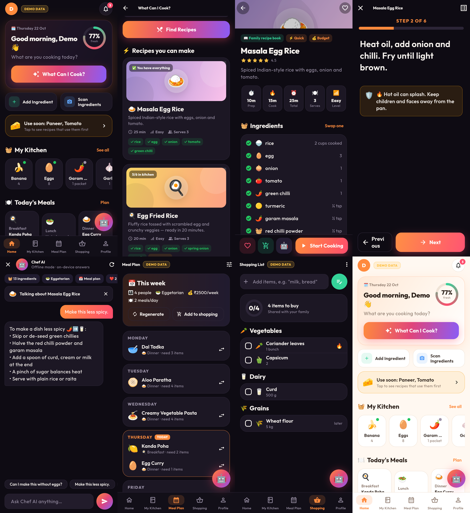

# 🍳 Family Food Assistant

**Tell it what's in your kitchen → get recipes instantly → cook step by step → save favourites → shop for what's missing.**



A Flutter app for Android, iOS and Web/PWA, backed by Supabase (Auth, Postgres + Row Level Security, Storage, Edge Functions) with OpenAI powering *Chef AI*. It is built for the whole family, from children (with adult supervision) to grandparents, with large touch targets, big readable text and friendly language.

---

## Contents
1. [Project overview](#1-project-overview)
2. [Features](#2-features)
3. [Technology stack](#3-technology-stack)
4. [Requirements](#4-requirements)
5. [Flutter installation](#5-flutter-installation)
6. [Supabase setup](#6-supabase-setup)
7. [Database setup](#7-database-setup)
8. [Supabase SQL schema](#8-supabase-sql-schema)
9. [Row Level Security policies](#9-row-level-security-policies)
10. [Edge Function setup](#10-edge-function-setup)
11. [AI API configuration](#11-ai-api-configuration)
12. [Environment variables](#12-environment-variables)
13. [Android build instructions](#13-android-build-instructions)
14. [iOS build instructions](#14-ios-build-instructions)
15. [Web deployment](#15-web-deployment)
16. [QR code generation](#16-qr-code-generation)
17. [Troubleshooting](#17-troubleshooting)
18. [Testing](#18-testing)
19. [Project structure](#19-project-structure)

---

## 1. Project overview

The main journey:

```
Open app → See kitchen ingredients → Tap "What Can I Cook?" → Get recipes
        → Open recipe → Cooking Mode → Save recipe → Add missing ingredients to shopping list
```

**Low lag by design.** "What Can I Cook?" shows results instantly from a built-in recipe book of 27 recipes that runs on the phone. Personalised Chef AI recipes then load in parallel a few seconds later. All data comes from a local cache first, so screens open immediately. Supabase syncs in the background, and changes made offline are queued and sent when the connection returns.

**Works with no setup.** Without any keys the app runs in **Demo Mode**: sample data, offline recipes, and an offline Chef AI that answers common questions (substitutions, "I have 20 minutes", kids' food, less spicy, budget). Add your Supabase and OpenAI keys to turn on accounts, family sharing, and the full AI features.

## 2. Features

| Area | What works |
|---|---|
| **Auth** | Email/password sign-up & login, forgot password, Google sign-in (optional), logout, **account deletion** (server-side), splash + onboarding |
| **Home** | Greeting, kitchen freshness ring, big **What Can I Cook?** button, quick add / scan, "use soon" alert, kitchen chips, today's breakfast/lunch/dinner, 🔥 family cooking streak, Ask Chef AI, recently viewed |
| **My Kitchen** | Add / edit / delete / ± quantity, units, purchase & expiry dates, category, notes, 🟢 Fresh 🟡 Expiring 🔴 Expired, search, filter by freshness & category, sort (expiry, name, category, quantity), swipe-to-delete with undo |
| **Scan Ingredients** | 📷 photo → Chef AI vision → confirm list → added to kitchen (needs the AI backend) |
| **What Can I Cook?** | Instant on-device matches + AI recipes; choose which ingredients to use; filters: under 30 min, kid-friendly, breakfast/lunch/dinner; free-text requests ("South Indian, no frying") |
| **Recipe detail** | Art header, rating, prep/cook/total time, servings, difficulty, ✓ have / + missing ingredients, steps, nutrition, substitutions ("Swap one" asks Chef AI), safety notes, allergy warnings; ❤️ Save · 🛒 Add missing · 🤖 Ask Chef AI · 🍳 Start Cooking |
| **Cooking Mode** | STEP X OF Y, very large text, Back/Next buttons 68 px tall, built-in timers detected from steps ("simmer 10 minutes"), automatic safety reminders (knife, hot oil, pressure cooker, boiling water, oven, raw meat), extra "ask a grown-up" for child profiles, screen stays awake, finish → streak +1 |
| **Chef AI** | Streaming chat that knows your kitchen, diet, allergies, saved recipes, meal plan and family size; can be about a specific recipe; suggestion chips; offline fallback answers; history saved |
| **Meal Planner** | People, weekly budget (₹), diet, preferences, meals per day, use-my-kitchen → 7-day plan; regenerate, swap a meal (instant alternatives or "ask AI"), save, add the whole week to the shopping list |
| **Shopping list** | Add (quick or detailed), delete, check/uncheck, quantity, category, priority (later / normal / 🔥 urgent), auto-grouped into Vegetables, Fruits, Dairy, Meat, Eggs, Grains, Spices, Other; "move bought items to My Kitchen" |
| **Family** | Create a family, invite code, join, members with roles (👨 Dad 👩 Mom 🧒 Child 👵 Grandma…), shared kitchen, shopping list, meal plan and favourites; leave family. Enforced by RLS |
| **Profile** | Name, photo (Supabase Storage), age group, diet (Vegetarian/Vegan/Eggetarian/Non-veg/Jain/Other), preferences, allergies (with clear warning), favourites, dislikes, spice level, theme (auto/light/dark), notification toggles |
| **Notifications** | Local reminders: 🍅 ingredient expiry, meal reminders, shopping reminder, weekly plan reminder (Android & iOS) |
| **Offline** | Kitchen, shopping list, saved & recently viewed recipes, meal plan, profile, chat history all cached; offline banner; outbox sync on reconnect |
| **Errors** | Friendly messages for no internet, AI unavailable, timeouts, auth failures, database errors, invalid AI output. Raw errors are never shown |
| **Demo Mode** | Sample ingredients, recipes, meal plan, shopping list and family, clearly labelled **DEMO DATA**, resettable |

Child safety: child profiles store only a nickname and age group, AI prompts force mild, supervised instructions, and the server prompt refuses anything that isn't about food. Nutrition is labelled as an estimate and **the app makes no medical claims**.

## 3. Technology stack

| Layer | Choice |
|---|---|
| App | Flutter 3.47 / Dart 3.13, Material 3, Riverpod 3 (state), go_router (navigation) |
| Backend | Supabase: Auth, PostgreSQL + RLS, Storage (avatars), Edge Functions (Deno/TypeScript) |
| AI | OpenAI Chat Completions with **strict JSON schemas** (structured outputs) + streaming + vision, called **only** from the Edge Function |
| Offline | shared_preferences JSON cache + ordered outbox queue, connectivity_plus |
| Device | flutter_local_notifications, wakelock_plus, image_picker |
| CI/CD | GitHub Actions: analyze, test, APK, GitHub Release, GitHub Pages |

## 4. Requirements

- Flutter **3.47+** (stable) with Dart 3.13+
- **Android:** Android Studio (SDK 36, build-tools), JDK 17, a phone with Android 6.0+ (API 23)
- **iOS:** a Mac with Xcode 26+, an Apple ID (free, for your own device) or an Apple Developer Program membership (US$99/yr, for TestFlight and the App Store)
- A [Supabase](https://supabase.com) project (the free tier is fine) and the [Supabase CLI](https://supabase.com/docs/guides/cli)
- An [OpenAI API key](https://platform.openai.com/api-keys) with billing enabled
- Python 3 (only for the QR tool)

## 5. Flutter installation

```bash
# macOS (Homebrew) — or follow https://docs.flutter.dev/get-started/install
brew install --cask flutter
flutter doctor            # fix anything it reports (Android SDK licenses: flutter doctor --android-licenses)

git clone <your repo> && cd family_food_assistant
flutter pub get
flutter run               # runs in Demo Mode — no keys needed
```

## 6. Supabase setup

1. Create a project at [supabase.com/dashboard](https://supabase.com/dashboard).
2. **Project Settings → API**: copy the **Project URL** and the **anon / publishable** key into `.env` (see §12).
3. **Authentication → Providers → Email**: enabled by default. Choose whether users must confirm their email.
4. **Authentication → URL Configuration → Redirect URLs**: add
   - `familyfood://login-callback` (Android/iOS deep link)
   - your web app URL, e.g. `https://<user>.github.io/<repo>/app/`
5. *(Optional)* **Google sign-in**: Authentication → Providers → Google, add the OAuth client ID and secret from Google Cloud Console, then set `GOOGLE_SIGN_IN_ENABLED=true` in `.env`.
6. Link the CLI:
   ```bash
   supabase login
   supabase link --project-ref YOUR_PROJECT_REF
   ```

## 7. Database setup

Run the schema once (it is safe to re-run):

- **Dashboard:** SQL Editor → New query → paste [`supabase/schema.sql`](supabase/schema.sql) → **Run**
- **or CLI:** `psql "$SUPABASE_DB_URL" -f supabase/schema.sql`

Optional sample data for development: sign up in the app, put your email at the top of [`supabase/seed.sql`](supabase/seed.sql), and run it. **Do not use it in production.**

The schema creates the tables, indexes, triggers, family RPCs, the `avatars` storage bucket, and all RLS policies.

## 8. Supabase SQL schema

| Table | Purpose | Key columns |
|---|---|---|
| `profiles` | One per user (auto-created on sign-up) | `id`=`user_id`, name, avatar_url, age_group, diet, allergies[], preferences[], favourites[], dislikes[], spice_level, family_id, cooking_streak |
| `user_preferences` | Theme & notification settings | `user_id` PK, notify_* flags, meal hours |
| `families` | A household | name, unique `invite_code`, created_by |
| `family_members` | Membership (one family per user) | family_id, user_id, display_name, role, is_admin |
| `ingredient_categories` | Reference list (10 categories) | id, label, emoji |
| `ingredients` | Kitchen inventory | user_id, family_id, name, quantity, unit, category, purchase_date, expiry_date, notes |
| `recipes` | Saved recipe snapshots (validated JSON) | user_id, family_id, name, source, `data jsonb` |
| `saved_recipes` | Favourites | user_id, family_id, recipe_id (unique per user) |
| `meal_plans` / `meal_plan_items` | Weekly plans | week_start, people, budget, diet, meals_per_day / day_index, meal_type, recipe_name, ingredients[] |
| `shopping_lists` / `shopping_list_items` | Shared lists | list auto-assigned by trigger; name, quantity, category, priority, checked |
| `ai_conversations` / `ai_messages` | Chef AI history (private) | user_id, title / role, content |
| `ai_usage` | Per-user daily AI counter (server-only) | user_id, day, count |

All tables use UUID primary keys, `created_at`/`updated_at` (with triggers), foreign keys with sensible `ON DELETE` rules, and indexes on `user_id`, `family_id`, `expiry_date`, list and plan ids. RPCs: `create_family`, `join_family`, `leave_family` (all `SECURITY DEFINER` and checked against `auth.uid()`).

## 9. Row Level Security policies

RLS is **enabled on every table**. The model:

- **Family-shared tables** (`ingredients`, `recipes`, `saved_recipes`, `meal_plans`, `meal_plan_items`, `shopping_lists`, `shopping_list_items`):
  `SELECT/UPDATE/DELETE` when `user_id = auth.uid()` **or** the row's `family_id` is a family you belong to. `INSERT` only as yourself, and only into your own family. Rows cannot be moved into another family, and the original owner is preserved on edit.
- **Private tables:** `profiles`, `user_preferences`, `ai_conversations`, `ai_messages` are visible to their owner only, **even within a family** (children's details are never shared).
- `families` / `family_members` are readable by members only. Changes happen only through the RPCs.
- `ai_usage` is written only by the Edge Function (service role).
- The `anon` role has **no table access**. Storage: anyone can view avatars, but users can only write to `avatars/<their-user-id>/…`.
- The app ships **only the anon/publishable key**. The service-role key exists only in Edge Function secrets.

**Verified:** [`supabase/tests/rls_test.sql`](supabase/tests/rls_test.sql) runs 20 isolation checks against a real PostgreSQL (strangers see nothing, spoofed `user_id` inserts are blocked, family sharing works, leaving removes access, anon is denied…). To run them locally:

```bash
createdb ffa_test
psql -d ffa_test -f supabase/tests/supabase_stubs.sql -f supabase/schema.sql
psql -d ffa_test -v ON_ERROR_STOP=1 -f supabase/tests/rls_test.sql            # → ALL RLS TESTS PASSED
psql -d ffa_test -v ON_ERROR_STOP=1 -f supabase/tests/client_payloads_test.sql # → CLIENT PAYLOAD TEST PASSED
```

## 10. Edge Function setup

```
Flutter AIService ──HTTPS + user JWT──▶ Edge Function "chef-ai" ──▶ OpenAI
        ▲                                 │ verifies user, rate-limits (ai_usage),
        └──── validated JSON / text stream ┘ builds safe prompts, strict JSON schemas
```

Deploy:

```bash
supabase secrets set OPENAI_API_KEY=sk-...your-key...
# optional:
supabase secrets set OPENAI_MODEL=gpt-4o-mini DAILY_AI_LIMIT=80 ALLOWED_ORIGINS=https://<user>.github.io

supabase functions deploy chef-ai
supabase functions deploy delete-account
```

`supabase/config.toml` sets `verify_jwt = false` for these two functions **because they verify the user's token themselves** (this also supports the new `sb_publishable_` keys). Do not remove the in-function checks.

| Function | Actions |
|---|---|
| `chef-ai` | `generate_recipes`, `recipe_detail`, `meal_plan`, `substitutions`, `shopping_list`, `scan_ingredients` (vision), `chat` (streaming) |
| `delete-account` | Leaves the family, removes avatar files, deletes the auth user (all rows cascade) |

Test the function:

```bash
curl -i "https://YOUR_PROJECT_REF.supabase.co/functions/v1/chef-ai" \
  -H "Authorization: Bearer <a user access token>" -H "Content-Type: application/json" \
  -d '{"action":"generate_recipes","context":{"ingredients":[{"name":"egg"},{"name":"rice"}]}}'
```

Deno unit tests: `deno test supabase/functions/chef-ai/prompts_test.ts`. These check that the schemas are valid for strict mode, that the context is bounded and sanitised, and that the child-safety prompt is included.

## 11. AI API configuration

| Secret (Edge Function) | Default | Notes |
|---|---|---|
| `OPENAI_API_KEY` | — | **Required.** Never put it in the app or in git |
| `OPENAI_MODEL` | `gpt-4o-mini` | Any Chat Completions model that supports structured outputs. Newer reasoning models (gpt-5 family, o-series) work too: temperature is dropped automatically |
| `OPENAI_VISION_MODEL` | = `OPENAI_MODEL` | Used for 📷 Scan Ingredients |
| `DAILY_AI_LIMIT` | `80` | Requests per user per day (cost control). Users then see a friendly "limit reached" message |
| `ALLOW_DEMO_AI` | off | `true` lets Demo Mode (public key, no login) use real AI. **Leave off in production** unless you accept the cost risk |
| `ALLOWED_ORIGINS` | `*` | Restrict CORS to your web app's origin |

Structured outputs: recipes, meal plans, substitutions, shopping lists and scans all use JSON schemas in strict mode ([`prompts.ts`](supabase/functions/chef-ai/prompts.ts)). Responses are validated on the server **and again in the app** (`Recipe.tryParseAi`, `AIService.parseMealPlan`), so malformed items are dropped and never displayed.

## 12. Environment variables

```bash
cp .env.example .env      # then edit .env
flutter run --dart-define-from-file=.env
```

| Variable | Where to find it | Example |
|---|---|---|
| `SUPABASE_URL` | Supabase → Settings → API | `https://abcd1234.supabase.co` |
| `SUPABASE_ANON_KEY` | Supabase → Settings → API Keys (anon or publishable) | `eyJ...` / `sb_publishable_...` |
| `AI_FUNCTION_NAME` | name of the deployed function | `chef-ai` |
| `AUTH_REDIRECT_URL` | must match Supabase redirect URLs and the app's deep link | `familyfood://login-callback` |
| `GOOGLE_SIGN_IN_ENABLED` | `true` after configuring Google | `false` |

`.env` is git-ignored. **Never** commit `.env`, `android/key.properties` or keystores. The OpenAI key and the Supabase service-role key go **only** into `supabase secrets set`.

## 13. Android build instructions

```bash
flutter doctor --android-licenses
flutter build apk --debug   --dart-define-from-file=.env    # build/app/outputs/flutter-apk/app-debug.apk
flutter build apk --release --dart-define-from-file=.env    # build/app/outputs/flutter-apk/app-release.apk
flutter build appbundle --release --dart-define-from-file=.env  # for Google Play (.aab)
# or all at once, copied into ./dist:
./tools/build_android.sh
```

Install on a phone: enable **Developer options → USB debugging** and run `flutter install`, or copy the APK to the phone and open it (allow "install unknown apps").

**Release signing** (required for Google Play and stable updates):

```bash
keytool -genkey -v -keystore ~/upload-keystore.jks -keyalg RSA -keysize 2048 -validity 10000 -alias upload
```
Create `android/key.properties` (git-ignored):
```properties
storePassword=...
keyPassword=...
keyAlias=upload
storeFile=/absolute/path/to/upload-keystore.jks
```
Without it, release builds fall back to debug signing. That is fine for testing, but not for publishing.

App id: `app.familyfood.family_food_assistant` (change `applicationId` in `android/app/build.gradle.kts` before publishing if you like).

**Cloud build (no Android Studio needed):** push to GitHub and tag a release (`git tag v1.0.0 && git push --tags`). The [workflow](.github/workflows/build.yml) builds the APK, attaches it to a GitHub Release, and gives you a real, permanent download URL.

## 14. iOS build instructions

You need a **Mac with Xcode**. iOS apps cannot be built on Linux or Windows.

1. `open ios/Runner.xcworkspace` → select **Runner** → **Signing & Capabilities** → choose your **Team**.
2. **Bundle identifier:** `app.familyfood.familyFoodAssistant`. Change it to something you own (e.g. `com.yourname.familyfood`). It must be unique in Apple's system.
3. Run on your own iPhone: `flutter run --release --dart-define-from-file=.env` (a free Apple ID works, but the app expires after 7 days).
4. **TestFlight** (needs the Apple Developer Program, US$99/yr):
   ```bash
   flutter build ipa --release --dart-define-from-file=.env
   ```
   Then upload `build/ios/ipa/*.ipa` with **Transporter** or Xcode → Organizer → Distribute. In [App Store Connect](https://appstoreconnect.apple.com) create the app, add testers, and enable a **public TestFlight link**. Put that link in `web_download/config.js → iosUrl`.
5. **App Store:** add screenshots, a privacy policy URL, a description, an age rating (food app; mention AI content), and fill in the App Privacy section (email, name, optional photo; data linked to the user). Then submit for review.

Already configured: camera and photo permission texts, the `familyfood://` URL scheme for auth redirects, the notification delegate, and the app icon.

> An `.ipa` **cannot** be installed on any iPhone from a normal download link. Use TestFlight or the App Store. Until then, the download page sends iPhone users to the **web app / PWA** (Safari → Share → Add to Home Screen).

## 15. Web deployment

The web build includes Login, Kitchen, Recipes, Chef AI, Meal Plan and Shopping. It is a full PWA (installable, cached app shell).

```bash
./tools/build_web.sh          # uses .env if present
# → deploy/            download landing page (index.html, config.js)
#   deploy/app/        Flutter web app (base href /app/)
```

Upload `deploy/` to any static host:

| Host | Command / steps |
|---|---|
| **GitHub Pages** | automatic on tag via `.github/workflows/build.yml` (Settings → Pages → Source: GitHub Actions) |
| Netlify | `npx netlify deploy --dir=deploy --prod` |
| Vercel | `npx vercel deploy deploy --prod` |
| Firebase Hosting | `firebase init hosting` (public dir `deploy`) → `firebase deploy` |
| Cloudflare Pages | `npx wrangler pages deploy deploy` |

Then edit `deploy/config.js` (or `web_download/config.js` before building) with the **real** URLs:

```js
androidApkUrl: "https://github.com/<you>/<repo>/releases/download/v1.0.0/family-food-assistant.apk",
iosUrl: "https://testflight.apple.com/join/XXXXXX",   // leave "" until published
webAppUrl: "app/",
```

Empty values show "coming soon" instead of a broken link. Add the web URL to Supabase **Redirect URLs** and to `ALLOWED_ORIGINS`.

```
Flutter app ─┬─ Android APK (GitHub Release) / Google Play
             ├─ iOS TestFlight / App Store
             └─ Web/PWA (deploy/app)
                      │
             Download landing page (deploy/index.html) ◀── QR code
```

## 16. QR code generation

Run this **after** the landing page is deployed at its public URL:

```bash
pip install "qrcode[pil]"
python3 tools/make_qr.py https://<your-deployed-download-page>/
# → qr_output/family_food_assistant_qr.png   (high-res, logo in centre, high error correction)
# → qr_output/qr_print.html                  (printable "Family Food Assistant · Scan to Install" page)
```

The tool **refuses** `http://`, `localhost`, private IPs and placeholder URLs, so the QR code never points to a temporary development address. Re-run it if the URL changes. The page detects Android/iPhone and highlights the right button.

## 17. Troubleshooting

| Problem | Fix |
|---|---|
| Login screen says "Cloud accounts are not connected yet" | You ran without `--dart-define-from-file=.env`, or the values are placeholders |
| "Chef AI is taking a short break" | Check `supabase functions logs chef-ai`. Common causes: `OPENAI_API_KEY` not set, OpenAI billing, or a wrong `OPENAI_MODEL` |
| AI works when logged in but not in Demo Mode | Expected. Set `ALLOW_DEMO_AI=true` if you want demo AI |
| `401 unauthorized` from the function | Session expired. Log out and in again. Check the function was deployed with the repo's `config.toml` |
| Google sign-in opens the browser but doesn't return | Add `familyfood://login-callback` to Supabase Redirect URLs. Check the Android intent filter / iOS URL scheme weren't changed |
| `new row violates row-level security policy` | Run the latest `schema.sql`. Make sure you're not writing a `family_id` you don't belong to |
| Family invite code "not found" | Codes are 6 characters with no 0/O/1/I. Check for typos |
| Notifications don't appear (Android 13+) | Allow notifications when prompted, or in system settings. Some phones need battery optimisation off for the app |
| `Execution failed for task ':app:checkReleaseDuplicateClasses'` / desugaring errors | `flutter clean && flutter pub get`. Make sure JDK 17 is used |
| iOS build: "No profiles for … were found" | Choose your Team in Xcode → Signing & Capabilities and use a unique bundle id |
| Web app shows a blank page on GitHub Pages | Build with the right `--base-href "/<repo>/app/"` (the workflow does this) |
| Offline edits not appearing on other phones | They sync when the device is back online. Pull to refresh on the other phone |

## 18. Testing

```bash
flutter analyze                 # static analysis — currently: No issues found
flutter test                    # 58 tests
deno test supabase/functions/chef-ai/prompts_test.ts
psql … supabase/tests/rls_test.sql   # see §9
```

| Suite | Covers |
|---|---|
| `test/navigation_test.dart` | onboarding → login, form validation, Demo Mode, all 5 tabs, What Can I Cook → recipe, Chef AI button |
| `test/repository_test.dart` | ingredient CRUD + offline persistence across restarts, merge, shopping list (dedupe, categories, check, move to kitchen), saved recipes, meal planner (generate, swap, save, shopping), suggestions, chat fallback, **sync engine** (offline queue, ordered flush, rejected writes), expiry notifications |
| `test/ai_service_test.dart` | request format (no secrets), validation of AI recipes and meal plans, malformed JSON, empty results, 5xx, 429, network errors, timeouts, streaming chat, substitutions, scan |
| `test/matcher_test.dart` | spec example (potato, tomato, onion, rice, egg), ranking, diets (incl. Jain), allergens, filters, recipe library integrity, offline Chef answers, kitchen filters, shopping groups |
| `test/models_test.dart` | freshness, JSON tolerance, AI recipe validation and clamping, streak logic, validators, safety tips, timers |

Device testing: `flutter run` on an Android phone (USB debugging), `flutter emulators --launch <id>` for an emulator, and `open -a Simulator && flutter run` for the iOS simulator on a Mac.

## 19. Project structure

```
lib/
  main.dart, app.dart
  core/
    config/env.dart                 build-time public config
    constants/app_constants.dart    categories, units, diets, roles
    theme/                          warm dark/light themes, palette
    services/                       AIService (Edge Function client), OfflineChef,
                                    AuthService, NotificationService
    utils/                          matcher, validators, safety, errors, emoji
  models/                           Ingredient, Recipe, MealPlan, ShoppingItem, Profile…
  data/                             session, offline-first repositories (providers.dart),
                                    LocalStore cache, SyncEngine outbox, recipe library, demo data
  features/
    auth/ home/ kitchen/ recipes/ meal_plan/ shopping/ profile/ family/ ai/
  widgets/                          shared cards, buttons, recipe art
  routes/                           go_router + bottom-nav shell with 🤖 Chef AI button
supabase/
  schema.sql, seed.sql, config.toml
  functions/chef-ai/ (index.ts, prompts.ts, prompts_test.ts), functions/delete-account/
  tests/ (RLS + payload tests, Supabase stubs)
web/                                PWA manifest, icons, splash
web_download/                       download landing page + config.js
tools/                              make_qr.py, build_web.sh, build_android.sh
.github/workflows/build.yml         CI: test → APK → Release → Pages
```

See [`docs/ARCHITECTURE.md`](docs/ARCHITECTURE.md) for diagrams of the data flow, AI pipeline and deployment.
